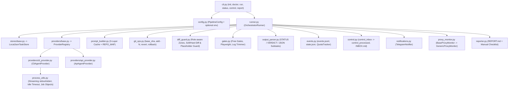
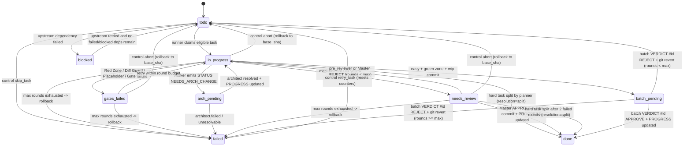

# AFK Orchestrator — System Architecture & Integration Contracts

## 1. Architectural Overview

The AFK Orchestrator is a headless, event-driven Python 3.11+ pipeline runner designed around four strict boundaries:

1. **Provider Independence (`BaseAgentProvider` + `ProviderRegistry`):** Models and CLI tools are never hardcoded. Profiles (`provider_fast`, `provider_main`, `provider_strong`, `provider_master`, `provider_reviewer_api`) are mapped to the 8 pipeline roles purely via `pipeline.yaml`. Each provider declares `can_edit_files: bool` (`false` by default for `kind: "api"`), and config validation rejects non-editing providers on writing roles (`worker_*`, `architect`, `refactorer`).
2. **Task Store Independence (`BaseTaskStore`):** Task selection, dependency DAG validation, subtask decomposition, and comment persistence go strictly through `BaseTaskStore`. `LocalJsonTaskStore` is shipped now; swapping to `GitHubIssuesTaskStore` in Team Mode requires zero changes in `runner.py`.
3. **Headless Event-Driven Core:** All runtime telemetry streams to append-only `.pipeline/events.jsonl` (with optional compact `[HH:MM:SS]` live stdout progress enabled by default and toggleable via `run --quiet`, using line-buffered stdio), current state is atomically snapshotted to `.pipeline/state.json`, attempt artifacts live under `.pipeline/runs/<run_id>/<task_id>/attempt_<n>/`, and control commands arrive race-free via `.pipeline/control_inbox/<cmd>.json`.
4. **Strict Runner Isolation (No Self-Repair):** The orchestrator code lives outside the target repository. Agents are strictly forbidden from touching protected `.pipeline/` state (`pipeline.yaml`, `tasks.json`, `state.json`, `events.jsonl`, `runs/**`, `PROGRESS.md`, etc. — enforced by an Integrity Guard SHA-256 snapshot before/after every call, while excluding legitimate operator/runtime channels `control_inbox/**`, `INBOX.md`, `control.json`, and `console.log`) and from committing directly to Git (enforced by `base_sha` soft-reset). On any internal orchestrator error, the runner emits `orchestrator_fatal_error`, sends a fail-safe Telegram alert (if enabled), generates `REPORT.md`, and exits non-zero without attempting self-repair.

### 1.1 Module Diagram



---

## 2. Task Status Finite State Machine (FSM)

All tasks strictly transition within the 9 canonical statuses:
`todo`, `in_progress`, `gates_failed`, `needs_review`, `batch_pending`, `arch_pending`, `done`, `failed`, `blocked`.



### Key State Invariants

- **Batch Independence & Selective Rollback:** Every `easy` task entering `batch_pending` must have zero mutual `depends_on` (direct or transitive), disjoint `changed_files`, and `touched_yellow_zone == false`. It is recorded as an isolated `wip(task-<id>)` commit. `PROGRESS.md` is **not** updated until Master outputs `VERDICT #<id>: APPROVE`. Any `REJECT` executes `git revert --no-edit <wip_commit_sha>`, rolling back only that task without impacting approved siblings.
- **Hard Task Auto-Split:** After `workflow.hard_split_after_rounds` (default `2`) failed rounds on a `hard` task, the runner rolls back uncommitted edits and invokes read-only `planner` to emit 2–3 atomic subtasks. Downstream tasks depending on the parent are atomically rewired to the leaf subtasks, and the parent transitions to `done` with `resolution: "split"` and `subtask_ids: [...]` (excluded from the refactor counter).
- **Pre-Provider Safety Sequence:**
  1. Snapshot `base_sha = git rev-parse HEAD` and SHA-256 of protected `.pipeline/` files (Integrity Guard, excluding `control_inbox/**`, `INBOX.md`, `control.json`, `console.log`).
  2. Run provider non-interactively (`stdin=DEVNULL` for non-stdin modes, `PYTHONDONTWRITEBYTECODE=1` + `PYTHONUTF8=1`, `shutil.which` executable resolution, Windows Job Object / POSIX process group kill on timeout).
  3. Verify protected `.pipeline/` snapshot is byte-for-byte unchanged (agents never write to protected `.pipeline/` files).
  4. If `HEAD != base_sha`, run `git reset --soft <base_sha>` and emit `agent_commit_soft_reset`.
  5. Run `git add -N` on all untracked files outside `.pipeline/` and `.gitignore` so new files enter `git diff --name-status <base_sha>`, Diff Guard, Placeholder Guard, Red Zone test checks, and `diff.patch`.
  6. Run role-aware `evaluate_diff`:
     - `planner`, `pre_reviewer`, `reviewer`: strictly read-only (any repo change is a fatal Red Zone violation with rollback).
     - `architect`, `refactorer`: allowed outside a single task's `allowed_paths` (including `yellow_shared`), while Red Zone and the `M`/`D`/`R` existing-test ban remain enforced.
     - `worker_*`: full Red/Yellow/Green enforcement (optional `zones.enforce_allowed_paths_on_yellow`), `M`/`D`/`R` test ban (`A` permitted inside `allowed_paths`), soft/hard complexity diff limits (optionally excluding `zones.test_patterns` from production limits while enforcing a separate `hard_max_test_lines` ceiling; soft limit exceedance disables `batch_pending`, emits `diff_guard_soft_warning`, and injects `DIFF_GUARD_SOFT_WARNING` into reviewer prompts without rollback), and Placeholder Guard.
- **Step-Level Pause & Clean Abort Rollback:** `control abort` and `pause_after_current` are honored immediately after each provider step (before launching retries, gates, or reviews) as well as during backoff/hibernation loops; any unfinished active task (`in_progress`, `gates_failed`, `needs_review`) is rolled back to `active_task_base_sha` and returned to `todo` on `abort`, while `batch_pending` commits and `arch_pending` escalations are preserved.
- **Overnight Resilience (v0.2):**
  - **Streaming `stdout`/`stderr` & Idle Timeout:** `run_noninteractive_process()` streams `stdout`/`stderr` in dedicated UTF-8 reader threads, emits `provider_response_started` and updates `state.active_phase = "streaming:<role>"` on the first non-ANSI meaningful chunk, notifies Telegram on recovery after retries (`provider_recovered_after_retry`), and kills hung processes via optional `idle_timeout_seconds` only when both stream I/O and workspace file mtimes are idle.
  - **Free Transport Retries:** Fast pre-response failures (`duration < transport_failure_max_duration_seconds`, clean git tree, no meaningful stdout or connection/proxy error, non-permanent) retry with jittered delays (`provider_transport_retry`) without incrementing `task.attempts`, `review_rounds`, or `QuotaTracker`. Long or dirty writing-role failures bypass blind `provider_transient_retry` and return upward immediately.
  - **Fallback Providers & Hibernation:** On `429` or `quota_max_requests`, compatible `fallback_providers` are tried immediately (`provider_fallback_used`). When all candidates for a role are in cooldown, the runner enters `status = "hibernating"` with `resume_at`, emits `runner_hibernating`, sends a single Telegram alert, polls `control_inbox/` in short ticks (instant `abort`/`resume`), and emits `runner_woke_up` upon waking.
  - **Declarative Proxy Monitor (`proxy_monitor.py`):** Optional `GenericProxyMonitor` configured via `proxy_monitor:` (or an external gitignored `config_file`, e.g. `proxy_monitor.local.yaml`, with `${ENV_VAR}` expansion) supports TCP port probes, JSON status field probes (`route_field`, `last_ok_at_field`, `disabled_field`, `blockers_field`, `transient_error_field`), and regex log tail probes (`ok_patterns`, `transient_patterns`, `fatal_patterns`). It stores sanitized `proxy_health_status` in `state.json`, routes transient route-switching into free `transport_retry`, and immediately pauses with `pause_reason = "proxy_error"` on fatal blockers/service-down without burning retries.
  - **Sequential Account Switching:** Providers configuring `account_group`, `account_profile`, and `switch_command` switch accounts automatically before invocation when `state.active_accounts[group] != profile`, emitting `provider_account_switched` or failing fast on error (`provider_account_switch_failed`).

---

## 3. Exact Schemas

### 3.1 `pipeline.yaml` Schema

```yaml
schema_version: 1
project:
  name: string                     # Human-readable project name
  pipeline_dir: ".pipeline"        # Relative path to runtime directory (must be in .gitignore)
  agents_file: "AGENTS.md"
  agent_roles_dir: ".agents"
  anti_laziness_file: ".agents/anti_laziness_openai.md"
  tasks_file: "tasks.json"         # Relative to pipeline_dir unless absolute
  repo_map_ignore: [string]

providers:
  <profile_name>:
    kind: "cli" | "api"
    can_edit_files: bool           # Defaults: true for cli, false for api (must be false for api)
    # CLI fields (required when kind == "cli"):
    command: [string]              # Executable resolved via shutil.which
    prompt_mode: "stdin" | "arg" | "tempfile"
    args_template: [string]        # Placeholders: {prompt},{prompt_file},{output_file},{workdir},{role},{task_id},{model}
    output_parser: "plain" | "json_field" | "jsonl_last"
    output_json_path: string?      # Dot path when output_parser is json_field/jsonl_last
    # API fields (required when kind == "api"):
    base_url: string?              # OpenAI-compatible base URL
    api_key_env: string?           # Host env var holding bearer token
    headers: { string: string | EnvEntryConfig }
    max_tokens: int?
    temperature: float?
    # Common fields:
    model: string?                 # Required if kind == "api" OR args_template contains {model}
    env:                           # Supports ${VAR} (required), ${VAR:-default} (optional; omitted if ${VAR:-} unset),
      <KEY>: string | { from_env: string, optional: bool, default: string? }
    timeout_seconds: int           # Default: 900
    idle_timeout_seconds: int?     # Optional stream + workspace mtime + process-tree CPU idle kill timeout
    idle_check_process_cpu: bool?  # Optional per-provider override for workflow.idle_check_process_cpu
    anti_laziness: bool            # Default: false; appends anti_laziness_openai.md to Layer 1 static prefix
    rate_limit_patterns: [regex]
    rate_limit_cooldown_seconds: int  # Default: 900
    quota_window_seconds: int      # Default: 18000 (5 hours)
    quota_max_requests: int?       # Optional rolling window cap
    fallback_providers: [string]   # Optional fallback profiles tried on 429 / quota ceiling
    account_group: string?         # Optional account switch group (e.g., "agy")
    account_profile: string?       # Optional target profile within account_group (e.g., "pro")
    switch_command: [string]       # Required when account_group/account_profile set (30s timeout)

roles:
  planner: <profile_name>
  worker_easy: <profile_name>      # Must have can_edit_files: true
  worker_medium: <profile_name>    # Must have can_edit_files: true
  worker_hard: <profile_name>      # Must have can_edit_files: true
  pre_reviewer: <profile_name>
  reviewer: <profile_name>
  architect: <profile_name>        # Must have can_edit_files: true
  refactorer: <profile_name>       # Must have can_edit_files: true
  role_prompt_files: { <role>: string }  # Optional overrides

fallback_providers:                # Optional role-level fallback profiles
  <role>: [<profile_name>, ...]

zones:
  red_protected: [glob]
  test_patterns: [glob]
  yellow_shared: [glob]
  enforce_allowed_paths_on_yellow: bool  # Default: false (true enforces task.allowed_paths on yellow_shared for workers)

diff_guard:
  exclude_tests_from_limits: bool  # Default: true (test_patterns excluded from prod limits)
  hard_max_test_lines: int         # Default: 3000 (separate ceiling for new test lines)
  limits:
    # Legacy { max_files, max_lines } remains accepted and maps to hard_max_*
    easy:   { soft_max_files: int?, soft_max_lines: int?, hard_max_files: int, hard_max_lines: int }
    medium: { soft_max_files: int?, soft_max_lines: int?, hard_max_files: int, hard_max_lines: int }
    hard:   { soft_max_files: int?, soft_max_lines: int?, hard_max_files: int, hard_max_lines: int }
  architect_limit:  { soft_max_files: int?, soft_max_lines: int?, hard_max_files: int, hard_max_lines: int }
  refactorer_limit: { soft_max_files: int?, soft_max_lines: int?, hard_max_files: int, hard_max_lines: int }
  exclude_from_review: [glob]
  readonly_ignore_paths: [glob]    # Default: ["go.work.sum", "**/go.work.sum"] (ignored & cleaned for read-only roles)

placeholder_guard:
  enabled: bool
  extra_patterns: [regex]
  allow_in_paths: [glob]

gates:
  - name: string
    command: [string]
    timeout_seconds: int
    kind: "command" | "playwright"
    optional: bool
    env: { string: string | EnvEntryConfig }
    cwd: string?

workflow:
  max_attempts: int                # Default: 6 (strict ceiling on total worker attempts per task; overridable per task)
  max_review_rounds: int           # Default: 3
  max_gate_retries_per_round: int  # Default: 3
  hard_split_after_rounds: int     # Default: 2 (<= max_review_rounds)
  batch_review_size: int           # Default: 3
  refactor_every_n_tasks: int      # Default: 6 (0 disables periodic count trigger)
  refactor_on_stage_complete: bool # Default: true
  cleanup_ports: [int]
  max_transport_retries: int       # Default: 6 (free retries before response)
  transport_retry_delays_seconds: [int]  # Default: [3, 5, 10, 20, 30]
  transport_failure_max_duration_seconds: int  # Default: 120
  transient_retry_delays_seconds: [int]
  retry_on_timeout_readonly: int
  rate_limit_poll_seconds: float
  control_poll_seconds: float
  auto_commit: bool
  commit_prefix: string
  strict_clean_start: bool
  review_diff_exclude_patterns: [glob]  # Excluded from pre_reviewer/reviewer diff body (still shown in --stat & exclusion list)
  review_diff_max_file_lines: int       # Default: 400 (per-file diff line cap in review prompts)
  review_diff_max_chars: int            # Default: 80000 (total diff char cap in review prompts)
  idle_check_process_cpu: bool          # Default: true (tracks Windows JobObject/GetProcessTimes or POSIX /proc CPU activity)

notifications:
  telegram:
    enabled: bool
    bot_token_env: string
    chat_id_env: string
    timeout_seconds: int
    notify_on_provider_started: bool  # Default: false
    events: [string]               # Default: [run_started, task_done, task_failed, escalation, pause, run_finished, fatal_error]

proxy_monitor:
  enabled: bool                    # Default: false
  config_file: string?             # Optional external YAML path (relative to pipeline.yaml or absolute; supports ${ENV_VAR})
  apply_to_providers: [string]     # Explicit provider profile names monitored by this proxy
  proxy_host: string?              # Optional TCP probe host (e.g., "127.0.0.1")
  proxy_port: int?                 # Optional TCP probe port (e.g., 8080)
  tcp_timeout_seconds: float       # Default: 2.0
  status_json:                     # Optional declarative JSON status file probe
    path: string                   # Supports ${ENV_VAR}
    route_field: string?           # Dot-notation field path (e.g., "route" or "last_ok.route")
    last_ok_at_field: string?
    disabled_field: string?        # Boolean field: true => unhealthy / requires manual action
    blockers_field: string?        # List/string field: non-empty => requires manual action
    transient_error_field: string? # Dict/string/bool field => route_switching
    error_field: string?
  log_probes:                      # Optional declarative log tail regex probes
    - path: string                 # Supports ${ENV_VAR}
      tail_lines: int              # Default: 80
      ok_patterns: [regex]
      transient_patterns: [regex]
      fatal_patterns: [regex]
```

### 3.2 `tasks.json` Schema

```json
{
  "schema_version": 1,
  "tasks": [
    {
      "id": "T-001",
      "title": "Add healthcheck endpoint",
      "description": "Implement GET /health returning {\"status\": \"ok\"}.",
      "complexity": "easy",
      "status": "todo",
      "depends_on": [],
      "allowed_paths": ["src/api/health.py", "tests/api/**"],
      "context_files": ["src/api/app.py"],
      "verify_cmd": "pytest tests/api/test_health.py -q",
      "acceptance_criteria": [
        "GET /health returns HTTP 200 and JSON {\"status\": \"ok\"}"
      ],
      "stage": "stage-1",
      "attempts": 0,
      "review_rounds": 0,
      "pre_review_approved": false,
      "parent_task_id": null,
      "subtask_ids": [],
      "resolution": null,
      "wip_commit_sha": null,
      "final_commit_sha": null,
      "changed_files": [],
      "touched_yellow_zone": false,
      "pending_progress_note": null,
      "last_report": null,
      "comments": [],
      "failure_reason": null,
      "created_at": "2026-11-20T20:00:00Z",
      "updated_at": "2026-11-20T20:00:00Z"
    }
  ]
}
```

### 3.3 `events.jsonl` Schema (Append-Only Event Stream)

Each line is a self-contained UTF-8 JSON object:

```json
{
  "event_id": "evt_a1b2c3d4e5f6",
  "timestamp": "2026-11-20T20:01:12.345678Z",
  "run_id": "run_20261120_200000_ab12cd",
  "task_id": "T-001",
  "role": "worker_easy",
  "provider": "provider_fast",
  "event_type": "provider_invoked",
  "payload": {
    "static_prefix_sha256": "e3b0c44298fc...",
    "prompt_chars": 4820,
    "attempt_dir": ".pipeline/runs/run_20261120_200000_ab12cd/T-001/attempt_1"
  }
}
```

Canonical `event_type` values:
`run_started`, `run_finished`, `run_aborted`, `orchestrator_fatal_error`, `task_claimed`, `task_deferred_cooldown`, `task_status_changed`, `provider_invoked`, `provider_response_started`, `provider_recovered_after_retry`, `provider_succeeded`, `provider_failed`, `provider_rate_limited`, `provider_transport_retry`, `provider_transient_retry`, `provider_fallback_used`, `provider_account_switched`, `provider_account_switch_failed`, `agent_commit_soft_reset`, `stale_lock_recovered`, `crash_recovery_completed`, `gate_started`, `gate_passed`, `gate_failed`, `placeholder_guard_failed`, `red_zone_violation`, `yellow_zone_triggered`, `diff_guard_soft_warning`, `diff_guard_failed`, `pre_review_completed`, `review_completed`, `batch_review_started`, `batch_review_deferred`, `batch_verdict_received`, `escalation_triggered`, `architect_resolved`, `task_split`, `refactor_started`, `refactor_finished`, `refactor_reverted`, `git_committed`, `git_reverted`, `task_rolled_back`, `control_command_applied`, `inbox_consumed`, `pause_entered`, `pause_resumed`, `runner_hibernating`, `runner_woke_up`, `proxy_status_changed`, `proxy_error`, `report_generated`.

### 3.4 `state.json` Schema (Atomically Replaced Snapshot)

Written via temp-file + `fsync` + `os.replace()` with a 5-attempt Windows `PermissionError` retry loop:

```json
{
  "schema_version": 1,
  "run_id": "run_20261120_200000_ab12cd",
  "status": "running",
  "active_task_id": "T-001",
  "active_phase": "gates",
  "active_role": "worker_easy",
  "active_provider": "provider_fast",
  "paused": false,
  "pause_reason": null,
  "resume_at": null,
  "pause_after_current": false,
  "accepted_since_last_refactor": 2,
  "batch_queue": ["T-001", "T-002"],
  "processed_control_ids": ["cmd_01"],
  "last_control_command_id": "cmd_01",
  "provider_quotas": {
    "provider_fast": {
      "window_seconds": 18000,
      "max_requests": 120,
      "requests_in_window": 9,
      "request_timestamps": ["2026-11-20T19:45:00Z"],
      "cooldown_until": null,
      "last_rate_limited_at": null
    }
  },
  "active_accounts": {
    "agy": "pro"
  },
  "proxy_health_status": {
    "healthy": true,
    "state": "ok",
    "proxy_reachable": true,
    "active_route": "primary-gateway",
    "last_message": "11:47:34 proxy upstream ok via primary-gateway",
    "last_ok_at": "2026-11-22T08:47:34Z",
    "route_switching": false,
    "requires_manual_action": false,
    "fatal_reason": null,
    "blockers": [],
    "raw_excerpt": "...",
    "checked_at": "2026-11-22T08:47:40Z"
  },
  "updated_at": "2026-11-20T20:01:15Z"
}
```

### 3.5 Control Plane Schema (`.pipeline/control_inbox/<ts>_<id>.json` & Legacy `control.json`)

**Primary Race-Free Contract (Recommended for Web UI & CLI):**
External writers never mutate a shared file. Instead, each command is atomically written as a unique file inside `.pipeline/control_inbox/`:

```json
{
  "id": "cmd_8f42ab19cd",
  "action": "retry_task",
  "task_id": "T-003",
  "reason": "Updated missing API fixture",
  "issued_at": "2026-11-20T20:10:00Z",
  "processed_at": null,
  "result": null
}
```

Supported `action` values: `pause_after_current`, `resume`, `abort`, `retry_task`, `skip_task`.

After executing the command, the runner atomically writes the completed record (with `processed_at` and `result`) to `.pipeline/control_processed/<id>.json`, deletes the file from `control_inbox/`, appends `<id>` to `state.processed_control_ids`, and emits `control_command_applied`.

**Legacy Compatibility:** If an operator drops a single `.pipeline/control.json` file (either a single command object or `{"commands": [...]}`), the runner reads it read-only without rewriting it, deduplicates command IDs via `state.processed_control_ids`, and archives processed copies in `control_processed/`.

---

## 4. Integration Contracts

### 4.1 Future Web UI ("Mission Control": FastAPI + WebSocket/SSE + React)

A FastAPI server can be mounted directly over `.pipeline/` without modifying any orchestrator module:

| Direction | Path / Stream | Contract |
|---|---|---|
| **Read (Live Stream)** | `.pipeline/events.jsonl` | Tail file line-by-line (track byte offset) and broadcast each parsed `PipelineEvent` over WebSocket/SSE. |
| **Read (Current Snapshot)** | `.pipeline/state.json` | Poll or watch on mtime change; always safe to read due to atomic replace + Windows retry. Drives status badge, pause countdown (`resume_at`), and 5-hour quota gauges (`provider_quotas`). |
| **Read (Task Board)** | `.pipeline/tasks.json` | Renders Kanban/DAG columns by `status`, comments, rejection history, and `parent_task_id`/`subtask_ids` tree. |
| **Read (Attempt Artifacts)** | `.pipeline/runs/<run_id>/<task_id>/attempt_<n>/` | Serves `diff.patch`, `gates.log`, `raw_output.txt`, `parsed_output.json`, `last_report.md`, and `screenshots/*.png`. |
| **Read (Report)** | `.pipeline/REPORT.md` | Renders final summary and interactive manual QA checklist. |
| **Write (Commands)** | `.pipeline/control_inbox/<ts>_<cmd_id>.json` | Atomically write temp file + `os.replace()` into `control_inbox/`. Never edit `state.json` or `control_processed/`. Confirm execution by watching `control_command_applied` in `events.jsonl` or `control_processed/<cmd_id>.json`. |
| **Write (Mid-Run Notes)** | `.pipeline/INBOX.md` | Atomically write operator instructions; confirmed when `inbox_consumed` event fires. |

### 4.2 Future Team Mode (GitHub Issues & Multi-Worker Farm)

To scale from solo local execution to a multi-machine team farm:

1. **Swap `BaseTaskStore`:** Implement `GitHubIssuesTaskStore(BaseTaskStore)` backed by GitHub Issues + Projects/Labels:
   - `get_next_available_task()` -> queries open issues with label `status:todo`, verifies `depends_on` issue numbers are closed/`status:done`, and atomically claims via assignee/label lease (`status:in_progress`, `worker:<host>`).
   - `update_status()` -> swaps `status:*` labels and updates issue metadata block.
   - `add_subtasks()` -> creates linked sub-issues, updates downstream issue dependency references, and closes parent with label `resolution:split`.
   - `add_comment()` -> posts structured Markdown comments on the Issue/PR.
2. **Branch-Per-Task Git Strategy:** Wrap `GitOps` to create `agent/task-<id>` branches and open PRs on `APPROVE` instead of committing directly to the local branch.
3. **Centralized Event Sink:** Add a webhook/HTTP forwarding subscriber alongside `events.jsonl` in `EventBus.emit()` so multiple workers stream telemetry into one Mission Control instance.
